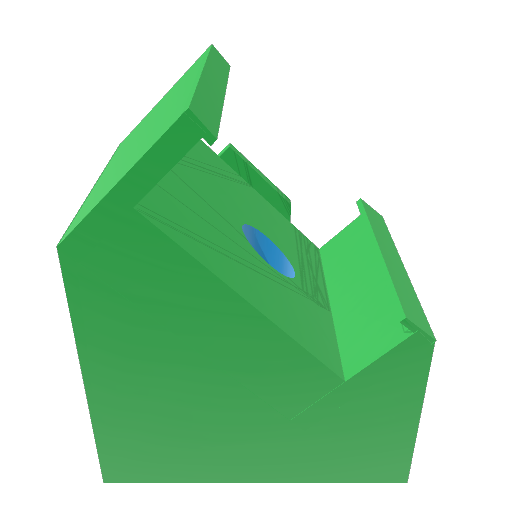

# Device mounting clips

3MF models for the 45-degree orbital-shaker setup in the research article under
submission. Model coordinates and dimensions are in millimetres.

| Device | Model | Preview |
|---|---|---|
| AX3 | [ax3.3mf](ax3.3mf) |  |
| GENEActiv 1.2 | [geneactiv.3mf](geneactiv.3mf) |  |
| ActiGraph LEAP | [leap.3mf](leap.3mf) |  |
| ActiGraph wGT3X-BT | [wgt3x-bt.3mf](wgt3x-bt.3mf) |  |
| ActiGraph GT9X Link | [gt9x-link.3mf](gt9x-link.3mf) |  |
| SENS motion | [sens-motion.3mf](sens-motion.3mf) |  |

[dimensions.csv](dimensions.csv) records transformed build-envelope width (X),
depth (Y) and height (Z), rounded to 0.1 mm, and model SHA-256 checksums.
Dimensions describe model geometry, not printed-part tolerances. Previews are
embedded 3MF thumbnails. Printer, material and slicer settings are unspecified.

Models, previews and dimension records are distributed under **GPL-3.0-only**;
see [LICENSE](../LICENSE).

Maintainer: [Millen James Theophilus](https://github.com/miltheo).
