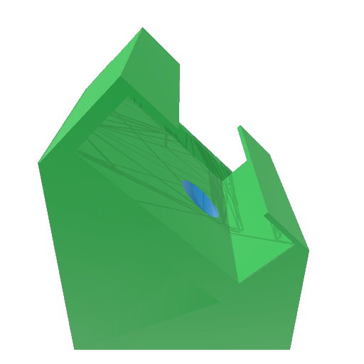

# Device mounting clips

3MF models for the 45-degree orbital-shaker setup in the research article under
submission. Model coordinates and dimensions are in millimetres.

| Device | Model | Preview |
|---|---|---|
| AX3 | [AX3_angled2.3mf](AX3_angled2.3mf) |  |
| GENEActiv 1.2 | [GENEActiv_angled_v5.3mf](GENEActiv_angled_v5.3mf) |  |
| ActiGraph LEAP v2 | [LEAP_angled.3mf](LEAP_angled.3mf) |  |
| ActiGraph wGT3X-BT | [GT3X_angled_v7.3mf](GT3X_angled_v7.3mf) |  |
| ActiGraph GT9X Link | [GT9X_angled.3mf](GT9X_angled.3mf) |  |
| SENS motion | [SENS_angled.3mf](SENS_angled.3mf) |  |

[dimensions.csv](dimensions.csv) records transformed build-envelope width (X),
depth (Y) and height (Z), rounded to 0.1 mm, and model SHA-256 checksums.
Dimensions describe model geometry, not printed-part tolerances. Previews are
embedded 3MF thumbnails. Device associations follow the table above; embedded
model titles may differ. Printer, material and slicer settings are unspecified.

Maintainer: [Millen J. Theophilus](https://github.com/miltheo).
