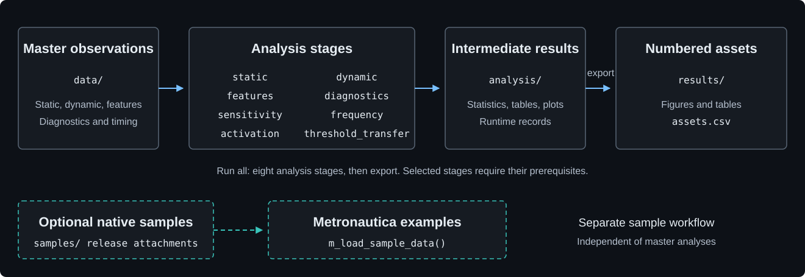

# WAM

Wearable Accelerometers Metrology (WAM): master observations and R analyses
supporting the associated research article under submission.

WAM reproduces selected code-generated article assets from the supplied masters.
Native recordings are optional examples for [Metronautica](https://github.com/miltheo/metronautica);
they are not required to reproduce these analyses.

## Workflow



[Full reproduction](code/README.md#reproduce-everything) ·
[Selected stages and prerequisites](code/README.md#run-a-selected-stage) ·
[Output index](code/OUTPUTS.md)

## Get started

Requires R >= 4.1, Metronautica and the [study dependencies](code/README.md#installation).
Run these commands in a terminal from the WAM repository root:

```sh
Rscript code/run.R --check
Rscript code/run.R all
Rscript code/checks/check_results.R
```

`all` includes export. For one analysis, use a
[named stage](code/README.md#run-a-selected-stage); prerequisites are explicit.
[Verification options](code/README.md#verification).

## Contents

| Directory | Purpose |
|---|---|
| [code](code/README.md) | Analysis stages, figures, settings and checks |
| [data](data/README.md) | Full-cohort master observations and input checksums |
| [samples](samples/README.md) | Optional native-recording catalogue; payloads are separate release attachments |
| [3d-clips](3d-clips/README.md) | Mounting models, previews and model dimensions |

Generated `analysis/` and `results/` directories are excluded from Git. The export
stage writes numbered assets and their checksums to `results/assets.csv`.

## Methods and reproducibility

Measurement definitions and study specifications are provided in the research
article under submission. Function parameters and package methods are documented
in [Metronautica](https://github.com/miltheo/metronautica).
The [code guide](code/README.md#metronautica-compatibility) records the tested engine revision;
each analysis stage records its runtime environment and package API hashes.

## Citation and licence

[CITATION.cff](CITATION.cff) provides software citation metadata. Cite the research
article under submission for study methods and findings.

**GPL-3.0-only** applies to the WAM code, master observations, native sample
recordings, mounting models and previews; see [LICENSE](LICENSE).

Maintainer: [Millen James Theophilus](https://github.com/miltheo),
[ORCID](https://orcid.org/0000-0001-9823-7177).
[Report an issue](https://github.com/miltheo/wam/issues) with the command, error and
`sessionInfo()`; attach the relevant stage session record where available.
