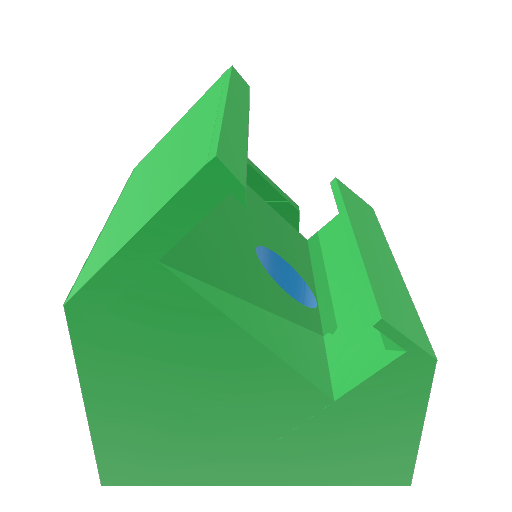
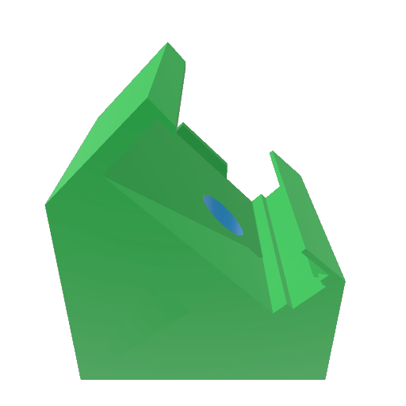

# Device mounting clips

Device-specific angled mounting clips for the 45° orbital-shaker configuration
shown in Figure 2 of the manuscript.

## Models

The original 3MF files are provided below. Previews are the thumbnails embedded
in those files, not new renders.

| Device model | Model file | Preview |
|---|---|---|
| AX3 | [AX3_angled2.3mf](AX3_angled2.3mf) |  |
| GENEActiv 1.2 | [GENEActiv_angled_v5.3mf](GENEActiv_angled_v5.3mf) |  |
| ActiGraph LEAP v2 | [LEAP_angled.3mf](LEAP_angled.3mf) |  |
| ActiGraph wGT3X-BT | [GT3X_angled_v7.3mf](GT3X_angled_v7.3mf) |  |
| ActiGraph GT9X Link | [GT9X_angled.3mf](GT9X_angled.3mf) |  |
| SENS motion | [SENS_angled.3mf](SENS_angled.3mf) |  |

## File details

Open the files in an application that supports 3MF. The model unit is millimetres;
the original geometry, component transforms and build items are retained.
Printer, material and slicer settings are not specified here.

Original filenames and embedded metadata have been preserved. Some internal
model titles retain earlier prototype names, including `LEAP_flat`; use the
device-to-file mapping above to identify the intended device. In particular,
`GT3X_angled_v7.3mf` is the wGT3X-BT clip.

The [model dimensions and checksums](dimensions.csv) identify the device
associations, model filenames and SHA-256 checksums.

[Model dimensions](dimensions.csv) give width (X), depth (Y) and height (Z)
in millimetres, rounded to 0.1 mm. They are bounding-box extents of the complete
3MF build after applying all component and build transforms, rather than
measurements of printed clips. File checksums identify the measured models.
